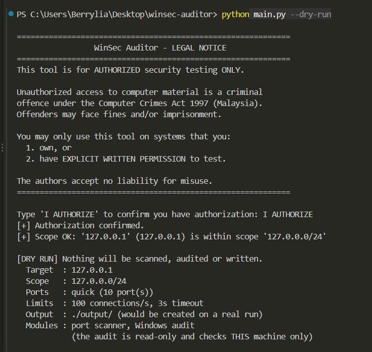
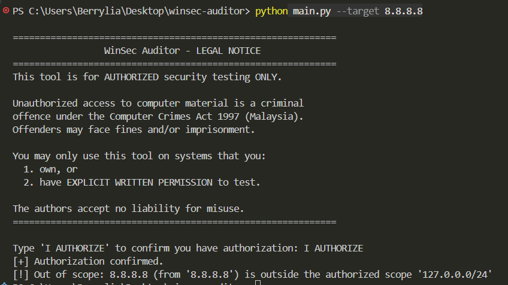
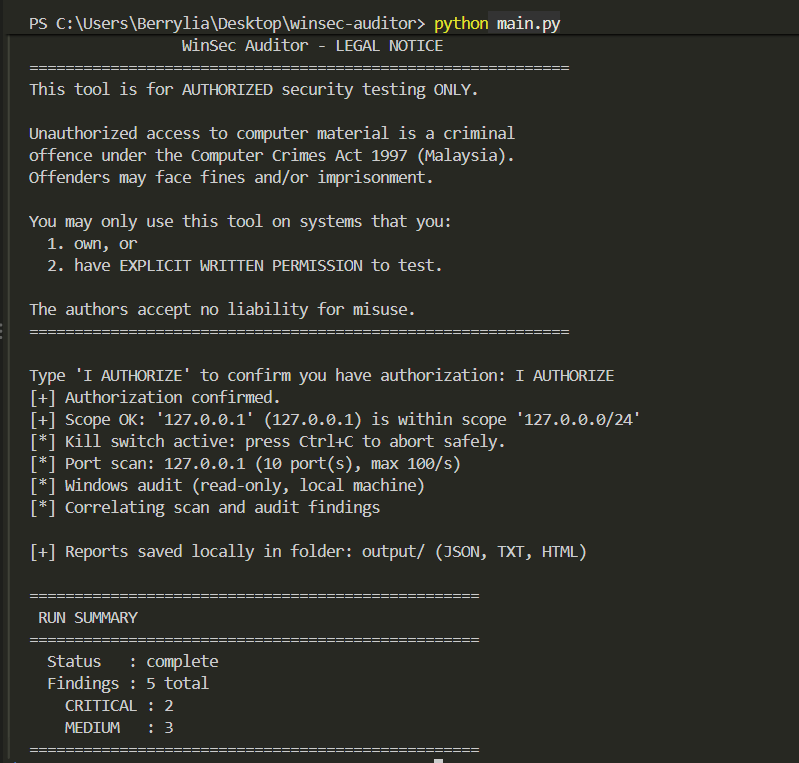
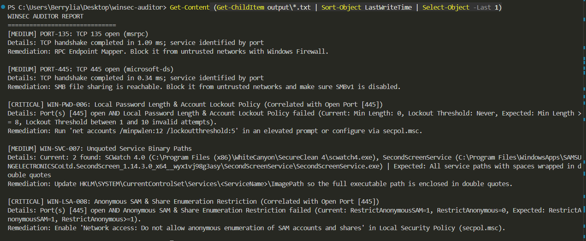

# WinSec Auditor

**WinSec Auditor** is a local Windows compliance scanner and port auditing tool for ethical hackers and system administrators. It scans TCP ports, audits eight Windows security settings (read-only), and correlates open ports with misconfigurations to produce a report with remediation advice.

> **For authorised testing only.** Read the [Rules of Engagement](#rules-of-engagement-roe) and the [Legal Disclaimer](#legal-disclaimer) before use.

## Attack Category

**Auditing** - Windows compliance and misconfiguration scanner (with a supporting TCP port scanner).

## Attack Lifecycle Mapping

| Phase | What the tool does |
|---|---|
| Reconnaissance / scanning | TCP connect scan of the chosen ports, with rate limiting |
| Enumeration | Service identification from banners and port numbers; collection of local Windows settings |
| Vulnerability analysis | Eight CIS-referenced configuration checks |
| Correlation | A failed check is raised to CRITICAL when one of its related ports is open (for example, weak SMB settings and port 445 open) |
| Reporting | JSON, text and HTML reports with remediation advice |

The tool **stops before exploitation by design**. It detects and reports, and it never attacks.

## Features

- Threaded TCP connect scanner with a rate limiter, timeouts, banner reading and service labelling
- Eight read-only Windows checks:

| ID | Check |
|---|---|
| WIN-SMB-001 | SMBv1 protocol status |
| WIN-FW-002 | Windows Firewall profile state (Domain, Private, Public) |
| WIN-RDP-003 | Remote Desktop and Network Level Authentication |
| WIN-UAC-004 | User Account Control level |
| WIN-DEF-005 | Windows Defender real-time protection |
| WIN-PWD-006 | Local password length and account lockout policy |
| WIN-SVC-007 | Unquoted service binary paths |
| WIN-LSA-008 | Anonymous SAM and share enumeration restriction |

- Correlation engine linking open ports to failed checks
- Reports saved locally in JSON, TXT and HTML
- Safety layer: legal notice, typed confirmation, scope enforcement, dry-run and kill switch

## Installation

1. Clone the repository:

   ```bash
   git clone https://github.com/shaikhhazman1/winsec-auditor.git
   cd winsec-auditor
   ```

2. Use **Python 3.10 or newer**:

   ```bash
   python --version
   ```

3. No third-party packages are needed (see `requirements.txt`).
4. Optional: create a virtual environment.

   ```bash
   python -m venv venv
   venv\Scripts\activate      # Windows
   source venv/bin/activate   # Linux / macOS
   ```

5. To get complete audit results on Windows, open the terminal **as Administrator**. Without it, some checks return an ERROR item with "Permission denied".

## Usage

```text
python main.py [-h] [--target TARGET] [--scope SCOPE] [--ports PORTS]
               [--rate RATE] [--timeout TIMEOUT] [--output OUTPUT]
               [--dry-run] [--scan-only | --audit-only]
```

| Flag | Default | Description |
|---|---|---|
| `--target` | `127.0.0.1` | Host to scan. Must fall inside `--scope`. |
| `--scope` | `127.0.0.0/24` | Authorised IP range (CIDR), single IP or hostname. |
| `--ports` | `quick` | A profile (`quick`, `windows`, `all`) or a list and ranges such as `22,80,1-1024`. |
| `--rate` | `100` | Maximum connections per second. Accepted range 1-500. |
| `--timeout` | `3` | Seconds to wait per connection. Accepted range 0.1-30. |
| `--output` | `./output/` | Folder for the reports. Results stay on this machine. |
| `--dry-run` | off | Print what would run, then exit. Nothing is scanned, audited or written. |
| `--scan-only` | off | Run only the port scanner. |
| `--audit-only` | off | Run only the Windows audit. |

`--scan-only` and `--audit-only` cannot be combined.

### Examples

```bash
# Preview a run without touching anything
python main.py --dry-run

# Default run on localhost (scan, audit, correlation, reports)
python main.py

# Scan the Windows-related ports more gently
python main.py --ports windows --rate 50

# Scan a lab machine you own (target must be inside the scope)
python main.py --target 192.168.56.101 --scope 192.168.56.0/24 --scan-only

# Windows audit only, custom output folder
python main.py --audit-only --output ./results/
```

### What happens on every run

1. A legal notice is shown, and you must type `I AUTHORIZE` exactly. Anything else exits.
2. The target is resolved, and every IP it resolves to must be inside `--scope`. Otherwise the tool refuses to continue.
3. With `--dry-run`, the plan is printed and the tool exits.
4. The kill switch is armed, then the port scan, the Windows audit and the correlation run.
5. Reports are written to the output folder, and a summary is printed.

`--help` shows usage and examples without running anything.

### Startup banner

```text
============================================================
                 WinSec Auditor - LEGAL NOTICE
============================================================
This tool is for AUTHORIZED security testing ONLY.

Unauthorized access to computer material is a criminal
offence under the Computer Crimes Act 1997 (Malaysia).
Offenders may face fines and/or imprisonment.

You may only use this tool on systems that you:
  1. own, or
  2. have EXPLICIT WRITTEN PERMISSION to test.

The authors accept no liability for misuse.
============================================================

Type 'I AUTHORIZE' to confirm you have authorization:
```









### Output

Reports are saved as `report_<date>_<time>.json`, `.txt` and `.html` in the output folder. Each finding has a severity, details and remediation advice. The reports list findings and failed checks. Checks that passed are not listed. The `output/` folder is excluded from Git.

### Exit codes

| Code | Meaning |
|---|---|
| `0` | Completed normally, or a dry-run finished |
| `1` | Refused (authorisation not confirmed, target out of scope), invalid `--ports`, or nothing to run |
| `2` | Invalid command-line arguments (for example `--rate 0`) |
| `3` | A module failed. A partial report was still written. |
| `130` | Aborted by the user with Ctrl+C |

## Ethical Considerations

This tool can be misused like any scanning tool, so the safety layer runs first and is not optional.

| Guardrail | How it works | Why |
|---|---|---|
| Legal notice | A banner citing the Computer Crimes Act 1997 (Malaysia) appears on every run. | The user is told the legal risk before anything happens. |
| Typed confirmation | The exact phrase `I AUTHORIZE` is required. Wrong input, Ctrl+C or closed input all exit. | A typed phrase is a deliberate act. A habitual `y` is not. |
| Safe defaults | Target `127.0.0.1`, scope `127.0.0.0/24`. | An accidental run can only touch your own machine. |
| Scope enforcement | Every IP the target resolves to must be inside the scope. Errors and IPv4/IPv6 mismatches are refused. | A hostname can resolve to several addresses. A failure never becomes "allowed". |
| Rate and timeout limits | `--rate` is capped at 500 connections per second and must be at least 1. | The scanner cannot be set up to flood a host. |
| Dry-run | `--dry-run` previews the run after the scope check and does nothing else. | Users can check their settings with no effect. |
| Kill switch | Ctrl+C stops the scan and audit safely and saves partial results. | A clean stop that keeps what was found. |
| Read-only audit | The Windows audit only reads the registry and runs read-only commands. | The tool never changes the system it inspects. |
| Local data only | Reports are saved in the local output folder. The tool does not transmit data. | Findings can contain sensitive configuration details. |

## Rules of Engagement (RoE)

These rules apply to anyone who runs this tool. The tool enforces the scope, the rate limits and the kill switch. The other rules depend on you following them.

### 1. Authorised scope

- Only test systems that you **own**, or that you have **explicit written permission** to test.
- The default scope is localhost (`127.0.0.1`, `127.0.0.0/24`).
- For this project, the authorised scope is **[DESCRIBE THE LAB, e.g. our own Windows VM and a Kali VM on a host-only network, 192.168.56.0/24]**.
- Set `--scope` to the exact range you are authorised to test, and keep it as small as possible.
- The Windows audit reads the machine it runs on, so that machine must also be one you are authorised to audit.
- Third-party systems, university networks and public internet hosts are out of scope unless written permission exists.

### 2. Time windows

- Test only inside the window agreed with the system owner, in writing.
- For this project's lab: **[STATE DAYS AND HOURS, e.g. during lab sessions on ...]**.
- For a real engagement, the written authorisation must state the start and end date and time. Do not run the tool outside it.
- Avoid peak usage hours on systems that other people depend on.
- The tool does not check the time of day. Staying inside the window is the operator's responsibility.

### 3. Permitted techniques

- TCP connect scanning of the ports you list, against the target in scope, within the rate and timeout limits.
- Banner reading on open ports to identify services.
- Read-only inspection of local Windows security settings.
- Saving results to the local output folder.

### 4. Prohibited actions

- Running the tool without authorisation, or outside the agreed scope or time window.
- Exploiting any weakness the tool reports, or using findings to gain access.
- Denial of service, flooding, or scanning at a rate that disrupts a host.
- Changing, disabling or deleting settings, files or logs on a system.
- Copying, exfiltrating or sharing sensitive data found during a test.
- Editing the tool to remove or bypass the disclaimer, scope check, rate limits or kill switch.
- Publishing findings about a system you do not own without the owner's consent.

### 5. Emergency stop procedure

1. Press **Ctrl+C once** and wait a few seconds. The tool stops safely, writes a report with the results so far, and marks it as partial (exit code 130).
2. Pressing **Ctrl+C a second time** forces an immediate exit. **No report is saved in that case.**
3. On Windows you can also press **Ctrl+Break**, or close the terminal window.
4. If the tool is unresponsive, end `python.exe` in Task Manager.
5. If a target shows signs of disruption, stop at once, tell the system owner, and do not run the tool again until the cause is known.

### 6. Checklist before every run

- [ ] I own the target, or I hold written permission.
- [ ] My `--scope` matches the authorised range exactly.
- [ ] I am inside the agreed time window.
- [ ] I ran `--dry-run` first and the plan looks correct.
- [ ] I know how to stop the tool (Ctrl+C once).

## Responsible Disclosure

If this tool is used in a real engagement and finds a vulnerability:

- **Who:** report it privately to the system owner or IT administrator. Do not publish it.
- **When:** within 48 hours of the finding.
- **How:** send the report files from the output folder, with the remediation steps, by **[CONTACT METHOD, e.g. the owner's security email or ticketing system]**. Share the details only with people who need them.
- **If a flaw is found in this tool itself:** open a private report to **[TEAM CONTACT EMAIL OR GITHUB SECURITY ADVISORY]**.

Delete reports once the owner has confirmed they have received them, unless the owner asks you to keep them.

## Legal Disclaimer

**WARNING:** This tool is intended for education and authorised security auditing only. Using it against any system without explicit written authorisation is illegal and prohibited. The Computer Crimes Act 1997 (Act 563) of Malaysia makes unauthorised access to computer material an offence. Users are solely responsible for their actions, and the authors accept no liability for misuse. This README is not legal advice.

## Limitations

- The Windows audit works on Windows only. On other systems it is skipped and the port scanner still runs.
- Some checks need administrator privileges. Without them they return an ERROR result.
- The audit checks **the machine it runs on**, not the `--target`. For that reason, correlation runs only when the target is this machine (loopback).
- The scanner is a TCP connect scanner only. It does not scan UDP.
- An open port on `127.0.0.1` means a service is listening locally. It does not prove the port is reachable from the network.
- Correlation marks a failed check as CRITICAL whenever one of its related ports is open, even if the weakness is not directly about that port.
- The scope is declared by the user, and the tool cannot verify that the user is authorised. It relies on the typed confirmation and these rules.
- DNS can change between the scope check and the scan.
- The tool does not enforce time windows.
- Reports list findings and failed checks, not the checks that passed.

## Project Structure

```text
winsec-auditor/
├── main.py                 # CLI and orchestration
├── core/
│   └── safety.py           # legal notice, scope check, kill switch
├── modules/
│   ├── scanner/            # TCP port scanner package
│   ├── win_audit.py        # Windows configuration checks
│   ├── adapters.py         # connects the scanner and audit to main.py
│   └── report.py           # correlation and JSON/TXT/HTML reports
├── tests/                  # unit tests
├── requirements.txt
└── LICENSE
```

Run the tests with:

```bash
python -m unittest discover -v
```

## Team

| Member | GitHub | Contribution |
|---|---|---|
| DAHIYAH | berrylia17 | CLI, legal notice, scope check, kill switch, dry-run, integration |
| MALEK | Malek | Port scanner |
| NUREEN | underratedtomato | Windows audit module |
| SHAIKH | shaikhhazman1 | Repository, report module, documentation |


## License

This project is licensed under the MIT License. See the [LICENSE](LICENSE) file for details.
